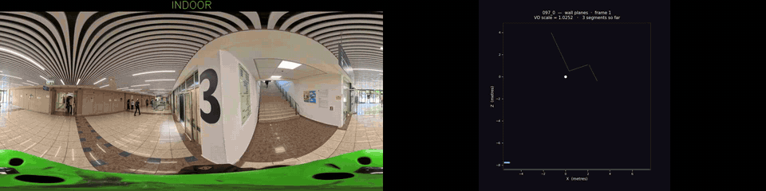

# DFPE: Floor Plans from 360° Video

Estimates the **floor plan** of the indoor parts of a **360° video**. It cuts the
video into indoor clips, estimates the room layout in each frame (HorizonNet
or LGT-Net), tracks the camera with visual SLAM (stella_vslam), and combines
both into a floor plan with direct_360_FPE.

Where the video goes indoors is decided by the companion project,
[raquelgold/indoor_outdoor_detection](https://github.com/raquelgold/indoor_outdoor_detection).
Its output, `transitions_confirmed.csv`, is this project's input.

## Demo



Video 097. Left: the original video with the INDOOR/OUTDOOR state. Right:
while indoors, the walls found so far (cyan) and the camera path; once
outside, the finished floor plan. Made with
`dpfe_pipeline/visualize_video_map_animated.py` (see [Visualisations](#visualisations)).

---

## Repository layout

```
dpfe_pipeline/                 the 6-stage pipeline
  pipeline.py                    orchestrator
  dpfe_paths.py                  all paths in one place (see "External dependencies")
data/videos/{id}/              per-video input: transitions_confirmed.csv (23 videos, 081–107)
direct_360_FPE/                floor-plan estimation (modified copy of upstream, see below)
configs/stella_vslam/          SLAM camera configs, one per resolution/fps
experiments/                   one-off studies, not part of the pipeline
docs/                          demo GIF
outputs/                       pipeline results (git-ignored)
```

### `direct_360_FPE` provenance

A copy of [EnriqueSolarte/direct_360_FPE](https://github.com/EnriqueSolarte/direct_360_FPE)
at commit `6a41911`, with local changes to 16 files (scale recovery, room-shape
solver, the `*_coords.json` export in `utils/eval_utils.py`, config). The full
diff against upstream is in [direct_360_FPE/LOCAL_CHANGES.patch](direct_360_FPE/LOCAL_CHANGES.patch).
Upstream's `mp3d_fpe_dataset/` helper folder was removed locally (the dataset
itself is on [HuggingFace](https://huggingface.co/datasets/EnriqueSolarte/mp3d_fpe)).

---

## Setup

### External dependencies

These are not in the repo. Default locations are under `$HOME`; each can be
overridden with the environment variable shown (read by `dpfe_paths.py`).

| Dependency | Default location | Env var | Source |
|---|---|---|---|
| HorizonNet | `~/HorizonNet` | `HORIZONNET_DIR` | [sunset1995/HorizonNet](https://github.com/sunset1995/HorizonNet) @ `c9a7df9` |
| LGT-Net | `~/LGT-Net` | `LGTNET_DIR` | [zhigangjiang/LGT-Net](https://github.com/zhigangjiang/LGT-Net) @ `0045359` |
| stella_vslam (library) | installed to `/usr/local/lib` | – | [stella-cv/stella_vslam](https://github.com/stella-cv/stella_vslam) @ `8ac1be4` |
| stella_vslam_examples `run_image_slam` | `~/stella_vslam_examples/build/run_image_slam` | `STELLA_SLAM_BIN` | [stella-cv/stella_vslam_examples](https://github.com/stella-cv/stella_vslam_examples) @ `defc69e` |
| ORB vocabulary | `~/orb_vocab.fbow` | `ORB_VOCAB` | [stella-cv/FBoW_orb_vocab](https://github.com/stella-cv/FBoW_orb_vocab) |
| venv interpreter | `~/venv/bin/python` | `DFPE_VENV_PY` | see below |

### Model checkpoints

| Model | Path |
|---|---|
| HorizonNet (mp3d) | `~/HorizonNet/ckpt/resnet50_rnn__mp3d.pth` |
| LGT-Net (mp3d) | `~/LGT-Net/checkpoints/SWG_Transformer_LGT_Net/mp3d/best.pkl` |

### Python environments

| Env | Used by | Key packages |
|---|---|---|
| `~/venv` (Python 3.12) | all `dpfe_pipeline/` glue scripts | `opencv-python`, `pandas`, `numpy`, `scipy`, `matplotlib`, `pillow`, `tqdm` |
| conda `dfpe` | `run_horizonnet.py`, `run_dfpe.py` → `direct_360_FPE/main_eval_scene.py` | `torch` 2.4.1+cu118, HorizonNet deps, `direct_360_FPE/requirements.txt` |
| conda `lgtnet` | `run_lgtnet.py` (imports LGT-Net source) | `torch==1.7.1`, `LGT-Net/requirements.txt` |

```bash
# dfpe (HorizonNet + direct_360_FPE)
conda create -n dfpe python=3.9 -y && conda activate dfpe
pip install torch --index-url https://download.pytorch.org/whl/cu118
pip install -r direct_360_FPE/requirements.txt
pip install -e direct_360_FPE

# lgtnet
conda create -n lgtnet python=3.8 -y && conda activate lgtnet
pip install -r ~/LGT-Net/requirements.txt
```

### SLAM program

Build and install stella_vslam first (see its README), then:

```bash
cd ~/stella_vslam_examples
mkdir -p build && cd build
cmake .. -DCMAKE_BUILD_TYPE=Release
make -j"$(nproc)"
```

**The SLAM camera config's `cols`/`rows` must equal the video's pixel size
exactly**, because clips are written at the video's native resolution.
`run_slam.py` picks a config from `configs/stella_vslam/` by resolution and fps:

| Config | Resolution | fps |
|---|---|---|
| `config_fps30_5760.yaml` (default) | 5760×2880 | 30 |
| `config.yaml` | 5760×2880 | 24 |
| `config_fps30_1920.yaml` | 1920×960 | 30 |
| `config_fps30.yaml`, `config_fps15.yaml` | 1024×512 | 30 / 15 (old downscaled tests) |
| `config_fps1.yaml` | 5760×2880 | 1 |

For a new resolution/fps, copy `config_fps30_5760.yaml`, set `Camera.cols`,
`Camera.rows` and `Camera.fps` (check with `ffprobe`), and pass it with
`run_slam.py --config`. The video **must be equirectangular (360°)**.

---

## Running it

All commands run from the repo root.

**Input:** `data/videos/{ID}/transitions_confirmed.csv`, made by the
[Indoor/Outdoor detection](https://github.com/raquelgold/indoor_outdoor_detection)
project. The 23 videos 081–107 are already included.

```bash
VIDEO=~/lock_direction/new_lock_direction/VID_20260603_161558_00_097.mp4

# HorizonNet (default)
~/venv/bin/python dpfe_pipeline/pipeline.py --video "$VIDEO"
# LGT-Net
~/venv/bin/python dpfe_pipeline/pipeline.py --video "$VIDEO" --layout_model lgtnet \
    --results_root outputs/dfpe_results_lgt
```

`--video_dir` defaults to `data/videos/{ID}` (the number at the end of the file
name). Use a separate `--results_root` per layout model: both share the same
clips, so their outputs would otherwise land in the same `{id}_{n}` folders.
`--fps` must match the video (default 30).

| Stage | horizonnet | lgtnet |
|---|---|---|
| 1 | extract_indoor_clips | extract_indoor_clips |
| 2 | HorizonNet (all frames) | SLAM |
| 3 | SLAM | setup_scene |
| 4 | setup_scene | LGT-Net (keyframes only) |
| 5 | DFPE | DFPE |
| 6 | generate_maps | generate_maps |

`--from_stage N` / `--to_stage N` run a sub-range. Results land in
`outputs/dfpe_results/{ID}_{clip_index}/`, one folder per indoor clip.

### Stage 1: `extract_indoor_clips.py`

Turns the confirmed transitions into indoor frame ranges, conservatively:

- `OUT_TO_IN` → indoor segment starts at `frame_max`
- `IN_TO_OUT` → segment ends at `frame_min - 1`
- If the first confirmed event is `IN_TO_OUT`, the video starts indoors.

Writes `clips/clip_NNN/rgb/frame_{id:06d}.jpg` plus `clips/indoor_segments.csv`.
An empty `transitions_confirmed.csv` (header only) means no indoor clip.

### Visualisations

Not part of the 6 stages:

```bash
# Top-down GIF of the map being built
~/venv/bin/python dpfe_pipeline/generate_map_animation.py --results_dir outputs/dfpe_results/097_0

# Extra "unified" floor plan (all walls, no room separation)
~/venv/bin/python dpfe_pipeline/generate_maps.py --results_dir outputs/dfpe_results/097_0 --unified

# Side-by-side video (the demo above): original + indoor/outdoor | map being built / final map
~/venv/bin/python dpfe_pipeline/visualize_video_map_animated.py \
    --video "$VIDEO" --video_dir data/videos/097 \
    --output outputs/097_indoor_map_viz.mp4
```

---

## Output

```
outputs/dfpe_results/
  {id}_0/
    {id}_0_coords.json             ← room corners, wall planes, scale, camera trajectory
    {id}_0_map_final_fp.png        ← estimated room polygons
    {id}_0_map_scale_recovery.png  ← wall-density occupancy heatmap
    {id}_0_map_wall_planes.png     ← RANSAC wall segments
    {id}_final_fp.png, scale_recovery.jpg, results.csv, ...   (DFPE's own renders)
  {id}_1/
    ...
```

---

## Troubleshooting

- **Re-running only checks that outputs exist, not whether inputs changed.**
  Every stage skips if its output exists. After replacing
  `transitions_confirmed.csv`, delete `data/videos/{id}/clips/` and
  `outputs/dfpe_results*/{id}_*` to force a real re-run.
- **"no clips found"**: `transitions_confirmed.csv` has no transitions, so the
  detectors never agreed. Check it in the Indoor/Outdoor project.
- **No `frame_trajectory.txt` after SLAM**: usually a camera-config mismatch
  (see [SLAM program](#slam-program)) or too little texture/motion in the clip.
- **LGT-Net stage does nothing**: it needs `vo_final/keyframe_list.txt`, so
  SLAM and setup_scene must finish first.
- **A long batch stopped with no error**: usually the session was killed.
  Re-run the same command; finished stages are skipped.
- **Two runs on the same clip give different rooms**: expected. DFPE's
  room-shape solver (`room_shape_estimator.py`, `plane_estimator.py`) uses
  unseeded `np.random`; on video 097, two DFPE runs on identical inputs gave
  room corners up to 9.5 m apart (scale and wall planes were identical).
  SLAM is also multi-threaded and not bit-for-bit repeatable. Compare results
  across several runs rather than trusting a single run.

---

## Experiments

Not part of the pipeline. Kept for reference; they depend on run data that is
not in the repo.

- `experiments/slam_scale_study/`: SLAM trajectory vs. MP3D-FPE ground truth
  on scene `1LXtFkjw3qL` (scale ratios, run-to-run comparisons). Reads
  `direct_360_FPE/slam_output/` and `direct_360_FPE/mp3d_fpe_dataset/`.
- `experiments/room_overlap_clipping/clip_room_overlaps.py`: removes overlaps
  between DFPE room polygons with Shapely (tried on video033/035 with LGT-Net).

---

## Original repositories and resources

### Used by the pipeline

| Repository | What it is used for here |
|---|---|
| [EnriqueSolarte/direct_360_FPE](https://github.com/EnriqueSolarte/direct_360_FPE) | Floor-plan estimation (DFPE); a modified copy is in `direct_360_FPE/` |
| [sunset1995/HorizonNet](https://github.com/sunset1995/HorizonNet) | Room-layout model (default) |
| [zhigangjiang/LGT-Net](https://github.com/zhigangjiang/LGT-Net) | Room-layout model (alternative) |
| [stella-cv/stella_vslam](https://github.com/stella-cv/stella_vslam) | Visual SLAM library (camera trajectory) |
| [stella-cv/stella_vslam_examples](https://github.com/stella-cv/stella_vslam_examples) | `run_image_slam`, the SLAM program the pipeline calls |
| [stella-cv/FBoW_orb_vocab](https://github.com/stella-cv/FBoW_orb_vocab) | ORB vocabulary file for SLAM |
| [raquelgold/indoor_outdoor_detection](https://github.com/raquelgold/indoor_outdoor_detection) | Companion project: produces `transitions_confirmed.csv` |

### Datasets

| Resource | What it is used for here |
|---|---|
| [MP3D-FPE (HuggingFace)](https://huggingface.co/datasets/EnriqueSolarte/mp3d_fpe) | Reference scene `1LXtFkjw3qL` for the SLAM/scale experiments in `experiments/slam_scale_study/` |

### Explored during the project (not used by the final pipeline)

| Repository | |
|---|---|
| [EnriqueSolarte/robust_360_8PA](https://github.com/EnriqueSolarte/robust_360_8PA) | Camera-pose estimation for 360° images |
| [DepthAnything/Video-Depth-Anything](https://github.com/DepthAnything/Video-Depth-Anything) | Video depth estimation |
| [mvlchallenge/mvl_toolkit](https://github.com/mvlchallenge/mvl_toolkit) | Multi-view layout toolkit |
| [EnriqueSolarte/ray_casting_mlc](https://github.com/EnriqueSolarte/ray_casting_mlc) | Multi-view layout consistency (self-training) |
